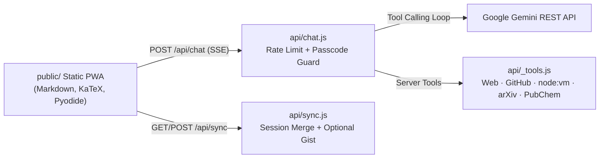

# Antigravity Studio — Cloud Agentic Workspace

A zero-dependency web and iPadOS workspace built with vanilla JavaScript, Node.js, and Vercel Serverless Functions. Visitors chat directly with Gemini using a server-side `GEMINI_API_KEY` proxy — no external API keys required in the browser.

**Live App (Vercel):** https://antigravity-hub-eight.vercel.app  
**Static Mirror (GitHub Pages):** https://happ3ns.github.io/antigravity-hub/

---

## Key Features

- **Server-Side Key & Multi-Turn Tool Loop (`api/chat.js`, `api/_tools.js`):**
  - Pre-installed `GEMINI_API_KEY` proxy with automatic model fallback (`gemini-3.8-flash` -> `gemini-3.5-flash` -> `gemini-3.5-flash-lite`) and per-IP sliding-window rate limiting (`25` requests/min).
  - Optional `STUDIO_PASSCODE` header verification (`X-Studio-Passcode`) for private locking.
  - Real tool execution over Server-Sent Events (`SSE`):
    - **Web Search & Fetch:** `web_search` (DuckDuckGo + Wikipedia fallback) and SSRF-protected `fetch_webpage`.
    - **GitHub Multi-Repo Agent:** `github_list_repos`, `github_read_tree`, `github_read_file`, `github_search_code`, and optional PAT-backed `github_commit_file`.
    - **Isolated JS Sandbox:** `run_javascript` in a `node:vm` sandbox (`1500ms` timeout, no filesystem/network/process access).
    - **Science Lookups:** `arxiv_search` and `pubchem_lookup`.
    - **Artifacts & Memory:** `create_artifact` (renders `.md` specs or sandboxed `.html` previews in the right-hand Studio pane with one-click download) and `save_memory_rule` (`AGENTS.md` vault).
- **In-Browser Python (`Pyodide` WASM):** Typing `/python <code>` lazy-loads Pyodide in the browser to execute real Python code and capture `stdout` and return values.
- **Multimodal & Code Attachments:** Attach or paste screenshots (`inlineData`) and code/text files right from the composer, and stop active generation mid-stream.
- **Cross-Device Sync & Repo Explorer:** Browse `Happ3ns/*` repositories in the Studio pane, sync sessions via `/api/sync` (with optional GitHub Gist persistence), and redact sensitive tokens cleanly in `tools/sync.js`.

---

## Architecture



---

## Running Locally

```bash
git clone https://github.com/Happ3ns/antigravity-hub.git
cd antigravity-hub
export GEMINI_API_KEY="your-google-ai-studio-key"   # Windows PowerShell: $env:GEMINI_API_KEY="..."
npm start
```

Open `http://localhost:4000` (default unlock PIN: `1234`, changeable in Settings).

### Optional Environment Variables (Vercel / Node)

| Variable | Purpose | Required |
| :--- | :--- | :--- |
| `GEMINI_API_KEY` | Google AI Studio key for zero-setup cloud chat | Yes (for server proxy) |
| `STUDIO_PASSCODE` | Restricts `/api/chat` and `/api/sync` to users entering matching Settings passcode | No |
| `GITHUB_TOKEN` | Higher GitHub API rate limits, private repo access, and `github_commit_file` writes | No |
| `SYNC_GIST_ID` | GitHub Gist ID used by `/api/sync` for persistent cross-device backup | No |

## License

MIT
